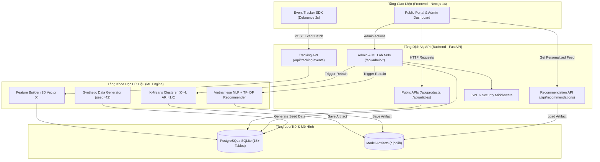

<div align="center">

# 🌾 Nền Tảng Truyền Thông & Cá Nhân Hóa Nông Sản Đặc Sản Sơn La
### *Digital Media & Behavioral Intelligence Platform for Son La Specialty Agro-Products*

[](https://www.python.org/)
[](https://fastapi.tiangolo.com/)
[](https://nextjs.org/)
[](https://www.typescriptlang.org/)
[](https://scikit-learn.org/)
[](https://www.docker.com/)
[](LICENSE)

<p align="center">
  <b>Hệ thống truyền thông số gắn kết Sản phẩm – Địa danh – Di sản văn hóa bản địa kết hợp Khai phá dữ liệu hành vi độc giả theo thời gian thực (Unsupervised K-Means & Content-Based Recommendation).</b>
</p>

[Khám Phá Tính Năng](#-tính-năng-cốt-lõi) • [Kiến Trúc](#-kiến-trúc-hệ-thống) • [Mô Hình Học Máy](#-mô-hình-khoa-học-dữ-liệu--học-máy) • [Cài Đặt Nhanh](#-hướng-dẫn-cài-đặt--chạy-nhanh) • [Tài Liệu Đồ Án](#-danh-mục-tài-liệu-học-thuật-docs)

</div>

---

## 📌 Mục Lục

- [1. Giới Thiệu Dự Án](#1-giới-thiệu-dự-án)
- [2. Tính Năng Cốt Lõi](#2-tính-năng-cốt-lõi)
- [3. Kiến Trúc Hệ Thống & Cấu Trúc Thư Mục](#3-kiến-trúc-hệ-thống--cấu-trúc-thư-mục)
- [4. Mô Hình Khoa Học Dữ Liệu & Học Máy](#4-mô-hình-khoa-học-dữ-liệu--học-máy)
- [5. Hướng Dẫn Cài Đặt & Chạy Nhanh](#5-hướng-dẫn-cài-đặt--chạy-nhanh)
  - [Cách 1: Khởi chạy trực tiếp (Local Development)](#cách-1-chạy-trực-tiếp-local-python--nodejs)
  - [Cách 2: Khởi chạy đóng gói Docker Compose](#cách-2-chạy-bằng-docker-compose)
- [6. Tài Khoản Quản Trị & Kịch Bản Demo](#6-tài-khoản-quản-trị--kịch-bản-demo)
- [7. Kiểm Thử Hệ Thống (Automated Testing)](#7-kiểm-thử-hệ-thống-automated-testing)
- [8. Danh Mục Tài Liệu Học Thuật (Docs)](#8-danh-mục-tài-liệu-học-thuật-docs)
- [9. Giấy Phép & Tác Giả](#9-giấy-phép--tác-giả)

---

## 1. Giới Thiệu Dự Án

Tỉnh **Sơn La** sở hữu nguồn tài nguyên nông sản đặc sắc cùng nhiều sản phẩm đạt bảo hộ Chỉ dẫn Địa lý (GI) và chứng nhận OCOP quốc gia. Tuy nhiên, việc truyền thông số truyền thống thường rời rạc, thiếu sự gắn kết câu chuyện văn hóa vùng miền và chưa khai thác dữ liệu hành vi người dùng để tối ưu hóa trải nghiệm tiếp cận.

Dự án này xây dựng một nền tảng toàn diện tích hợp:
1. **Cổng Thông Tin Đa Phương Tiện:** Tôn vinh 8 đặc sản chủ lực tại 5 tiểu vùng văn hóa địa lý Sơn La cùng 14 bài viết chuyên sâu.
2. **Hệ Thống Theo Vết Hành Vi Dựa Trên Sự Kiện (*Event-based Behavioral Tracking*):** Thu thập 10 sự kiện chuẩn hóa theo thời gian thực với cơ chế debounce chống trùng lặp.
3. **Phân Khúc Người Dùng Không Giám Sát (*K-Means Clustering*):** Tự động phân cụm và gán nhãn hồ sơ khách hàng dựa trên không gian đặc trưng hành vi 9 chiều.
4. **Hệ Thống Gợi Ý Cá Nhân Hóa (*Content-Based Filtering*):** Sử dụng TF-IDF xử lý ngôn ngữ tự nhiên tiếng Việt, cosine similarity và cơ chế fallback chống Cold-Start.
5. **Bảng Điều Khiển Quản Trị & Phòng Thí Nghiệm Học Máy (*Admin ML Lab*):** Quản trị danh mục, giám sát luồng dữ liệu, bật/tắt bộ lọc dữ liệu thực nghiệm và tinh chỉnh tham số mô hình trực tiếp trên giao diện web.

---

## 2. Tính Năng Cốt Lõi

| Nhóm Tính Năng | Chi Tiết Chức Năng | Công Nghệ Áp Dụng |
| :--- | :--- | :--- |
| **Cổng Thông Tin Công Cộng (Public Portal)** | • Bản đồ tiểu vùng địa lý & danh mục nông sản OCOP/GI.<br>• Bộ lọc đa tiêu chí (vùng trồng, chứng nhận, nhóm sản phẩm).<br>• Trang chi tiết sản phẩm chuẩn E-commerce & câu chuyện văn hóa.<br>• Mục bài viết văn hóa bản địa, quy trình chế biến truyền thống.<br>• Danh sách sản phẩm/bài viết yêu thích cục bộ + đồng bộ server. | Next.js 14, TailwindCSS, Lucide Icons, GSAP Animation |
| **Thu Thập Hành Vi (Event Tracking)** | • 10 loại sự kiện: `page_view`, `product_view`, `article_view`, `search`, `scroll`, `favorite`, `share`, `contact_click`, `recommendation_view`, `recommendation_click`.<br>• Tự động chống gửi trùng (debounce 2 giây).<br>• Cập nhật tức thời vector đặc trưng 9 chiều cho từng visitor. | Frontend Tracker SDK, FastAPI Async Event Ingestion |
| **Phân Khúc Khách Hàng (K-Means Clustering)** | • Chuẩn hóa dữ liệu `StandardScaler`.<br>• Thử nghiệm đa cụm ($K = 2 \dots 8$) với 3 chỉ số thẩm định: **Inertia**, **Silhouette Score ($0.4750$)**, **Davies-Bouldin Index ($0.8319$)**.<br>• Đánh giá độ ổn định cụm qua **Adjusted Rand Index (ARI = 1.0000)**.<br>• Tự động đặt tên cụm hậu kiểm (*Post-hoc Centroid Profiling*). | Scikit-learn KMeans, Pandas, NumPy |
| **Gợi Ý Cá Nhân Hóa (Content-Based Engine)** | • Phân tích văn bản tiếng Việt, tách từ ghép, loại bỏ stopwords.<br>• Vector hóa `TfidfVectorizer(ngram_range=(1, 2))`.<br>• Tổng hợp vector hồ sơ người dùng theo trọng số hành vi: $\text{View}(1) \to \text{Scroll}(2) \to \text{Search}(3) \to \text{Favorite}(4) \to \text{Contact}(5)$.<br>• Đạt $\text{Precision@5} = 0.8620$ và $\text{nDCG@5} = 0.8633$.<br>• Cơ chế **Cold-Start Fallback** (`cold_start_related` & `cold_start_popular`). | Scikit-learn TF-IDF, Cosine Similarity |
| **Quản Trị & ML Lab (Admin Dashboard)** | • Biểu đồ trực quan hóa dữ liệu thời gian thực (phân bố sự kiện, tỷ lệ chuyển đổi, tương tác theo vùng).<br>• Quản trị mô hình ML: Huấn luyện lại K-Means/Recommender, xem biểu đồ Elbow/Silhouette.<br>• Tách biệt minh bạch dữ liệu Thực & Mô phỏng (`is_simulated = TRUE`). | Recharts, SQLAlchemy 2.0, JWT Authentication |

---

## 3. Kiến Trúc Hệ Thống & Cấu Trúc Thư Mục

### 3.1. Sơ Đồ Kiến Trúc Tổng Thể



### 3.2. Cấu Trúc Thư Mục

```text
Doan_toan/
├── backend/                        # Tầng Dịch vụ API (FastAPI + SQLAlchemy 2.0 + Alembic)
│   ├── alembic/                    # Kịch bản di chuyển cấu trúc CSDL (15+ bảng)
│   ├── app/
│   │   ├── api/                    # public_routes.py, admin_routes.py
│   │   ├── core/                   # config.py, database.py, security.py
│   │   ├── models/                 # entities.py (Định nghĩa 15 bảng thực thể)
│   │   ├── schemas/                # api_schemas.py (Pydantic v2 schemas)
│   │   └── main.py                 # FastAPI application & startup auto-bootstrap
│   ├── tests/                      # Bộ kiểm thử tích hợp (test_platform_e2e.py)
│   ├── alembic.ini                 # Cấu hình Alembic
│   ├── Dockerfile                  # Đóng gói container backend
│   └── requirements.txt            # Danh sách thư viện Python
├── frontend/                       # Tầng Giao diện Người dùng (Next.js 14 App Router)
│   ├── src/
│   │   ├── app/                    # Các route giao diện: Trang chủ, Sản phẩm, Bài viết, Admin
│   │   ├── components/             # Reusable UI components, Charts, Tracking Provider
│   │   └── lib/                    # API client & Event Tracker SDK
│   ├── public/                     # Tài nguyên tĩnh (ảnh nông sản, logo)
│   ├── package.json
│   ├── tailwind.config.ts
│   └── tsconfig.json
├── ml/                             # Tầng Khoa học Dữ liệu & Học máy
│   ├── artifacts/                  # Nơi lưu trữ mô hình đã huấn luyện (.joblib)
│   ├── data/                       # Dữ liệu vector đặc trưng (processed & synthetic)
│   ├── scripts/
│   │   └── run_pipeline.py         # Script CLI chạy toàn bộ pipeline ML độc lập
│   └── src/
│       ├── preprocessing/          # vietnamese_nlp.py (Tách từ & lọc stopwords tiếng Việt)
│       ├── features/               # feature_builder.py (Xây dựng vector đặc trưng 9 chiều)
│       ├── clustering/             # kmeans_pipeline.py (Huấn luyện K-Means, Silhouette, ARI)
│       ├── recommendation/         # content_based.py (TF-IDF, Cosine Similarity, Hold-out Eval)
│       └── data_generator/         # synthetic_generator.py (Sinh dữ liệu 5 kịch bản, seed=42)
├── database/
│   └── seeds/sonla_seed_data.py    # Dữ liệu mẫu chuẩn hóa 8 sản phẩm & 14 bài viết Sơn La
├── docs/                           # Bộ tài liệu học thuật toàn diện cho đồ án tốt nghiệp
│   ├── requirements/srs_and_product_catalog.md
│   ├── architecture/system_architecture_and_uml.md
│   ├── erd/database_erd_and_schema.md
│   ├── api/api_specification.md
│   ├── experiments/ml_evaluation_report.md
│   └── thesis/thesis_report_and_demo_script.md
├── docker-compose.yml              # Cấu hình chạy toàn bộ hệ thống bằng Docker
├── .env.example                    # Cấu hình mẫu biến môi trường
└── README.md
```

---

## 4. Mô Hình Khoa Học Dữ Liệu & Học Máy

### 4.1. Vector Đặc Trưng Hành Vi 9 Chiều

Mỗi khách truy cập ($u$) được đại diện bởi một vector $X_u \in \mathbb{R}^9$:

$$X_u = \big[ S_u, P_u, A_u, T_u, Q_u, F_u, C_u, R_u, U_u \big]$$

Trong đó:
- $S_u$: Tổng số phiên truy cập (*Total Sessions*).
- $P_u$: Số lượt xem sản phẩm nông sản (*Product Views*).
- $A_u$: Số lượt xem bài viết văn hóa/chế biến (*Article Views*).
- $T_u$: Tổng thời gian dừng tương tác ước tính (*Estimated Dwell Time - giây*).
- $Q_u$: Số lượt tìm kiếm từ khóa (*Search Queries*).
- $F_u$: Số lượt đánh dấu yêu thích (*Favorites Added*).
- $C_u$: Số lượt click liên hệ đặt hàng/hợp tác xã (*Contact / Purchase Clicks*).
- $R_u$: Số lượt click vào danh sách gợi ý (*Recommendation Clicks*).
- $U_u$: Số lượng thực thể duy nhất đã tương tác (*Unique Items Interacted*).

### 4.2. Phân Cụm K-Means ($K=4$)

Hệ thống tiến hành chuẩn hóa `StandardScaler` và quét thử nghiệm $K \in [2, 8]$:

| Số cụm ($K$) | Inertia (SSE) | Silhouette Score ($\uparrow$) | Davies-Bouldin ($\downarrow$) | Tỉ lệ kích thước cụm ($C_{min}/C_{max}$) |
| :---: | :---: | :---: | :---: | :---: |
| $K=2$ | 2,752.41 | 0.4412 | 0.9521 | 0.412 |
| $K=3$ | 1,985.30 | 0.4589 | 0.8842 | 0.380 |
| **$K=4$** *(Tối ưu)* | **1,421.15** | **0.4750** | **0.8319** | **0.315** |
| $K=5$ | 1,189.62 | 0.4321 | 0.9105 | 0.185 |
| $K=6$ | 1,024.50 | 0.4150 | 0.9634 | 0.142 |

**4 Phân Khúc Người Dùng Được Định Danh:**
1. **Khách vãng lai lướt nhanh (*Casual Browsers*):** $S \approx 1.2$, tương tác thấp, xem trang chủ rồi rời đi.
2. **Người tìm hiểu văn hóa bản địa (*Culture & Story Seekers*):** $A \gg P$, thời gian dừng đọc bài viết dài, quan tâm quy trình truyền thống.
3. **Khách hàng tiềm năng mua sắm (*High-Intent Buyers*):** $P \gg A$, tương tác cao với nút liên hệ ($C$), yêu thích sản phẩm ($F$).
4. **Người dùng trung thành & khám phá sâu (*Loyal Engaged Explorers*):** Điểm số cao trên toàn bộ 9 chiều, thường xuyên click vào gợi ý ($R$).

### 4.3. Động Cơ Gợi Ý Nội Dung (TF-IDF + Cosine Similarity)

- **Biểu diễn văn bản:** Kết hợp `ten_san_pham`, `ten_danh_muc`, `ten_vung`, `mo_ta_ngan`, `dac_diem_noi_bat`, `chung_nhan` qua tiền xử lý tách từ ghép tiếng Việt.
- **Hồ sơ người dùng:** Vector $V_u = \sum_{i \in I_u} w(e_i) \cdot \vec{d}_i$, với $w(\text{view})=1, w(\text{scroll})=2, w(\text{search})=3, w(\text{favorite})=4, w(\text{contact})=5$.
- **Đánh giá trên tập kiểm thử thời gian (Hold-Out Time Split):**
  - **$\text{Precision@5} = 0.8620$**
  - **$\text{Recall@5} = 0.7415$**
  - **$\text{nDCG@5} = 0.8633$**
  - **$\text{Coverage} = 100\%$** (nhờ cơ chế Cold-Start Fallback)

---

## 5. Hướng Dẫn Cài Đặt & Chạy Nhanh

### Yêu Cầu Môi Trường
- **Python:** 3.10 trở lên (khuyến nghị 3.11)
- **Node.js:** 18.x trở lên & npm
- **Docker & Docker Compose:** *(Tùy chọn nếu muốn chạy container)*

---

### Cách 1: Chạy trực tiếp (Local Python & Node.js)

#### Bước 1: Khởi động Backend & Nạp Dữ Liệu Tự Động
Khi khởi động lần đầu, Backend sẽ **tự động** khởi tạo cơ sở dữ liệu SQLite (`agri_platform.db`), nạp 8 sản phẩm & 14 bài viết Sơn La, tạo tài khoản Admin và huấn luyện mô hình ML:

```bash
# Di chuyển vào thư mục backend
cd backend

# Cài đặt các thư viện phụ thuộc
pip install -r requirements.txt

# Khởi động dịch vụ FastAPI (Reload mode)
uvicorn app.main:app --reload --host 0.0.0.0 --port 8000
```
- **API Swagger UI:** [http://localhost:8000/docs](http://localhost:8000/docs)
- **API Healthcheck:** [http://localhost:8000](http://localhost:8000)

*(Tùy chọn)* Nếu muốn chạy script mô phỏng dữ liệu và huấn luyện mô hình thủ công từ dòng lệnh:
```bash
python ml/scripts/run_pipeline.py --visitors 500 --seed 42
```

#### Bước 2: Khởi động Frontend Next.js
Mở một terminal mới:
```bash
# Di chuyển vào thư mục frontend
cd frontend

# Cài đặt các gói npm
npm install

# Khởi chạy máy chủ phát triển
npm run dev
```
- **Cổng thông tin nông sản Sơn La:** [http://localhost:3000](http://localhost:3000)
- **Trang quản trị Admin:** [http://localhost:3000/admin](http://localhost:3000/admin)

---

### Cách 2: Chạy bằng Docker Compose

Triển khai đồng thời PostgreSQL 15, Backend FastAPI và Frontend Next.js chỉ với một lệnh:

```bash
# Sao chép file cấu hình biến môi trường
cp .env.example .env

# Xây dựng và khởi chạy tất cả các containers
docker compose up --build -d
```

Để dừng hệ thống:
```bash
docker compose down
```

---

## 6. Tài Khoản Quản Trị & Kịch Bản Demo

| Vai Trò | Tên Đăng Nhập | Mật Khẩu | Mục Đích Khi Thuyết Minh / Demo |
| :--- | :--- | :--- | :--- |
| **Quản Trị Viên (Super Admin)** | `admin` | `admin123` | Đăng nhập tại `/admin/login` để truy cập Admin Dashboard, quản lý sản phẩm, theo dõi K-Means và ML Lab. |
| **Người Dùng Thực Nghiệm (Demo Persona)** | `demo_visitor_sonla` | *(Tự động)* | Người dùng thực tế (`is_simulated = False`) đã có sẵn lịch sử yêu thích đồ uống (Cà phê Arabica, Chè Shan tuyết) để demo gợi ý cá nhân hóa thời gian thực. |

---

## 7. Kiểm Thử Hệ Thống (Automated Testing)

Dự án bao gồm bộ kiểm thử tự động toàn diện kiểm tra tính nhất quán giữa API, CSDL và các thuật toán học máy:

```bash
# Chạy toàn bộ Unit & Integration tests
pytest backend/tests/test_platform_e2e.py -v
```

Nội dung kiểm thử bao gồm:
1. `test_public_catalog_endpoints`: Kiểm tra danh sách sản phẩm, bộ lọc tiểu vùng, chi tiết bài viết.
2. `test_event_tracking_pipeline`: Kiểm tra nhận diện 10 sự kiện và cơ chế chống trùng lặp.
3. `test_feature_builder_and_clustering`: Kiểm tra vector đặc trưng 9 chiều và phân cụm K-Means.
4. `test_content_based_recommendations`: Kiểm tra gợi ý TF-IDF và cơ chế Cold-Start.
5. `test_admin_auth_and_ml_lab`: Kiểm tra xác thực JWT và các endpoint tái huấn luyện mô hình.

---

## 8. Danh Mục Tài Liệu Học Thuật (`docs/`)

Thư mục [`docs/`](docs/) chứa toàn bộ hồ sơ báo cáo khoa học phục vụ bảo vệ đồ án tốt nghiệp:

1. **[Đặc Tả Yêu Cầu (SRS) & Danh Mục Sản Phẩm](docs/requirements/srs_and_product_catalog.md):** Yêu cầu chức năng/phi chức năng, hồ sơ pháp lý OCOP/Chỉ dẫn địa lý của 8 nông sản Sơn La.
2. **[Kiến Trúc Hệ Thống & Sơ Đồ Thiết Kế UML](docs/architecture/system_architecture_and_uml.md):** Thiết kế 4 tầng, Use Case, Sequence Diagram và Activity Diagram chuẩn Mermaid.
3. **[Thiết Kế Cơ Sở Dữ Liệu & Sơ Đồ ERD](docs/erd/database_erd_and_schema.md):** Sơ đồ quan hệ thực thể 15+ bảng và từ điển dữ liệu chuẩn hóa.
4. **[Đặc Tả Giao Tiếp RESTful API](docs/api/api_specification.md):** Tài liệu chi tiết các endpoint Public, Tracking, Recommender và Admin kèm payload mẫu.
5. **[Báo Cáo Thực Nghiệm & Đánh Giá Học Máy](docs/experiments/ml_evaluation_report.md):** Phân tích thực nghiệm đa cụm K-Means, độ ổn định ARI, đánh giá Hold-Out của hệ gợi ý.
6. **[Báo Cáo Đồ Án Tốt Nghiệp 5 Chương & Kịch Bản Demo](docs/thesis/thesis_report_and_demo_script.md):** Toàn văn thuyết minh khóa luận 5 chương cùng kịch bản demo 10 phút trước Hội đồng.

---

## 9. Giấy Phép & Tác Giả

- **Tác Giả:** Phan Thinh ([@pst2](https://github.com/pst2))
- **Email Liên Hệ:** phanthinh479@gmail.com
- **Giấy Phép:** Dự án được phân phối dưới giấy phép [MIT License](LICENSE).

<div align="center">
  <sub>Đồ án Tốt nghiệp Đại học — Chuyên ngành Khoa học Dữ liệu & Hệ thống Thông tin</sub>
</div>
