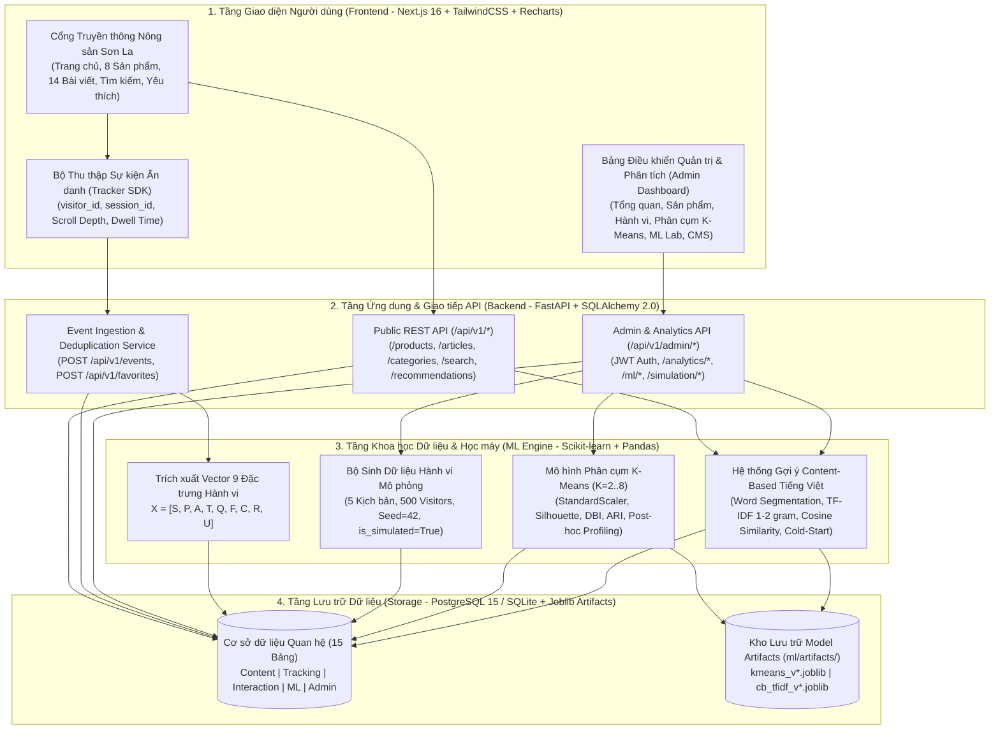
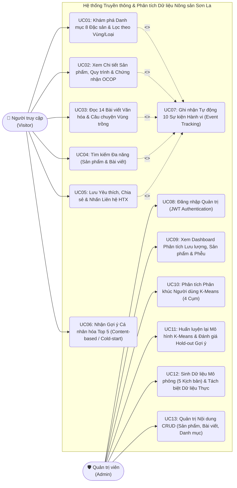
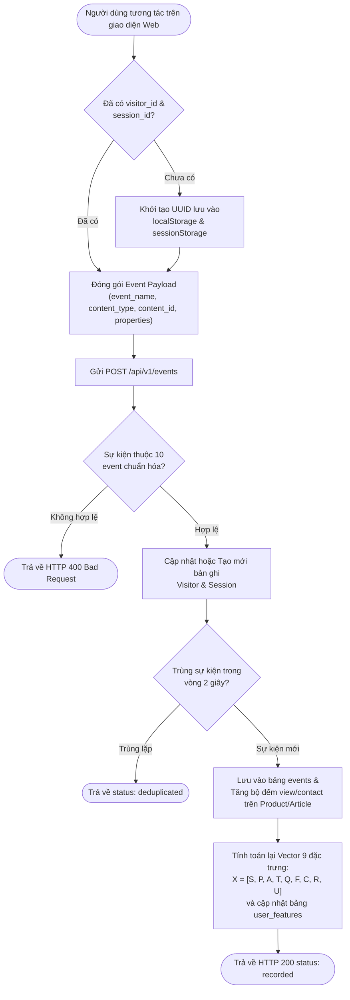
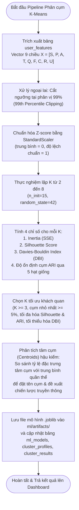
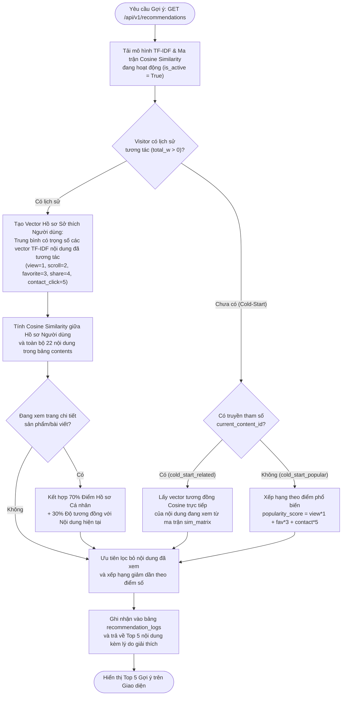
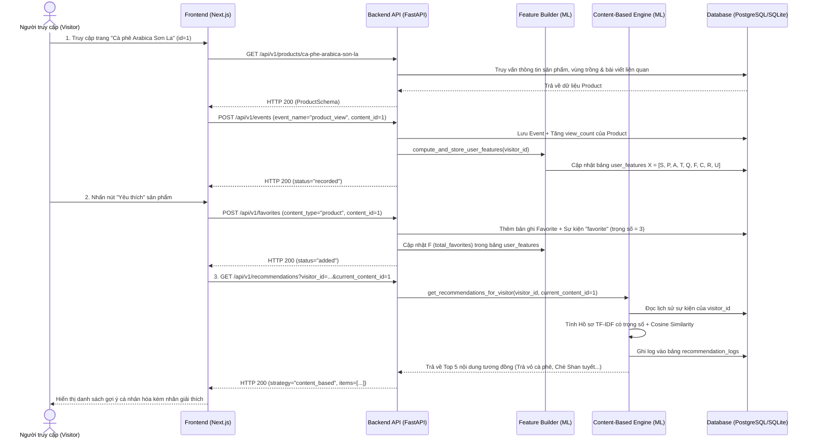
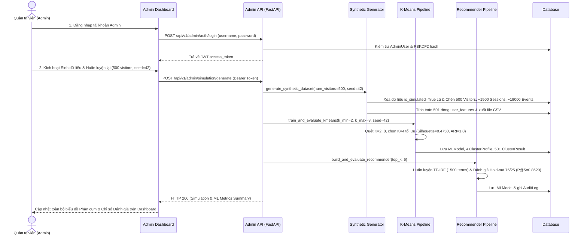

# KIẾN TRÚC HỆ THỐNG & SƠ ĐỒ THIẾT KẾ UML (USE CASE, ACTIVITY, SEQUENCE DIAGRAMS)

**Đề tài:** Xây dựng hệ thống truyền thông và phân tích dữ liệu hành vi người dùng cho sản phẩm nông nghiệp truyền thống địa phương (Tỉnh Sơn La)  
**Bàn giao Tuần 2 (Phase 1 Deliverable):** Kiến trúc tổng thể 4 tầng, Sơ đồ Use Case, Sơ đồ Hoạt động (Activity) và Sơ đồ Tuần tự (Sequence).

---

## 1. Kiến trúc Tổng thể Hệ thống (4-Layer Architecture)

Hệ thống được thiết kế theo kiến trúc phân tầng hiện đại, tách biệt rõ ràng giữa giao diện người dùng (Next.js App Router), tầng dịch vụ API (FastAPI), tầng cơ sở dữ liệu quan hệ (PostgreSQL / SQLite) và tầng xử lý Học máy (Scikit-learn K-means & Vietnamese TF-IDF Recommender):

---

## 2. Sơ đồ Ca sử dụng Tổng quát (Use Case Diagram)

---

## 3. Sơ đồ Hoạt động (Activity Diagrams)

### 3.1. Luồng Thu thập Sự kiện & Cập nhật Vector Đặc trưng Hành vi ($X$)

### 3.2. Luồng Huấn luyện & Hậu kiểm Phân cụm Người dùng K-Means

### 3.3. Luồng Gợi ý Nội dung Cá nhân hóa (Content-based & Cold-Start Fallback)

---

## 4. Sơ đồ Tuần tự (Sequence Diagrams)

### 4.1. Sơ đồ Tuần tự: Người truy cập Xem Sản phẩm, Yêu thích và Nhận Gợi ý Tức thời

### 4.2. Sơ đồ Tuần tự: Quản trị viên Sinh Dữ liệu Mô phỏng & Huấn luyện lại Mô hình

